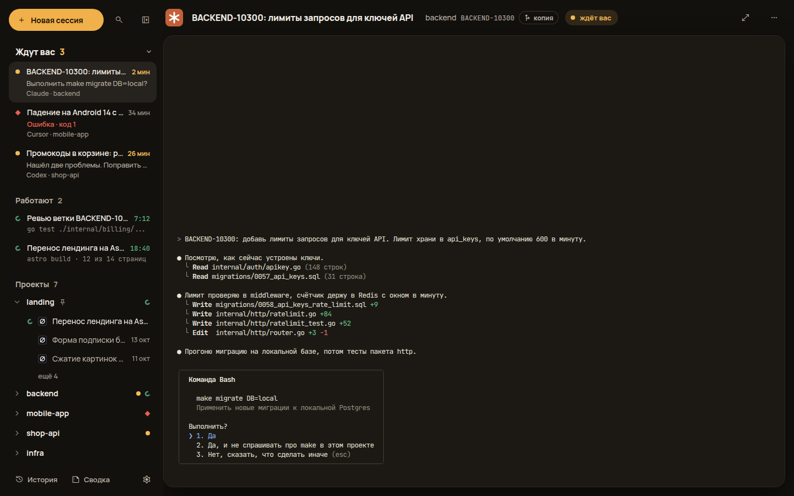
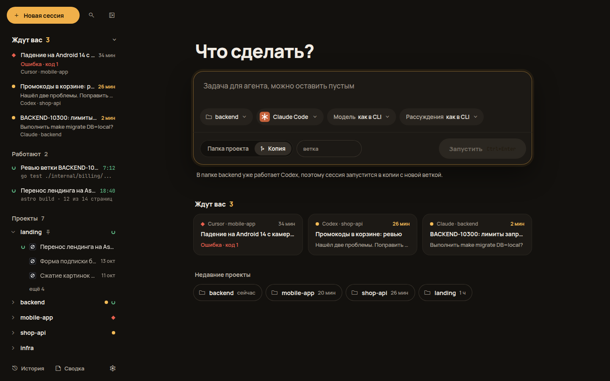
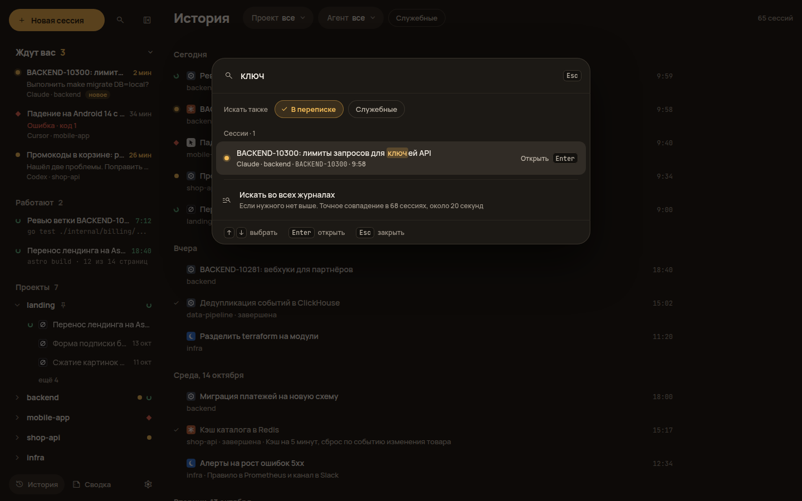
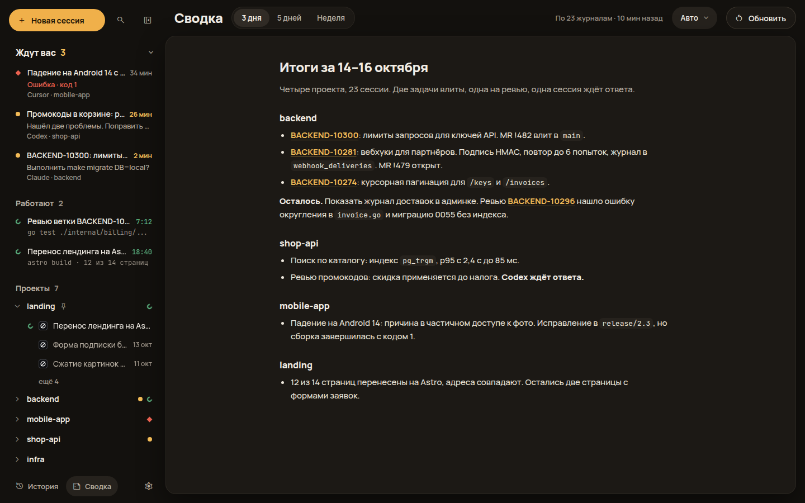
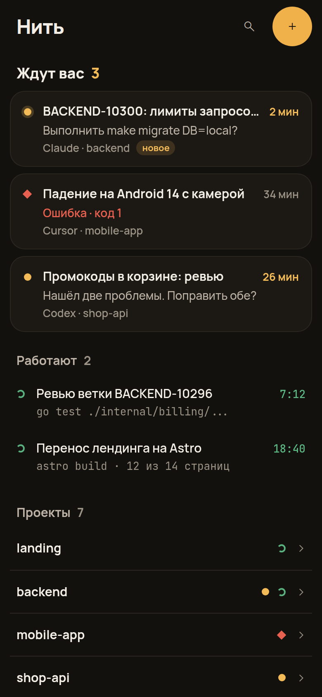

<p align="center"></p>

# Нить

[English](README.md) · **Русский**

«Нить» — локальное веб-приложение для работы с агентами для программирования: Claude Code, Codex,
Grok, Kimi и Cursor Agent. В нём агентов запускают, отвечают им в настоящем терминале, ищут старые
сессии и получают сводку за несколько дней. С телефона тоже.

<p align="center"></p>

## Что умеет

- **Запуск.** Новая сессия в папке проекта или в отдельной копии репозитория (git worktree) со своей
  веткой. Если в папке уже работает другой агент, «Нить» предлагает копию, чтобы агенты не правили
  одни и те же файлы. Модель и уровень рассуждений выбираются там же.
- **Кто ждёт ответа.** Панель слева делит сессии на «Ждут вас» и «Работают». Агент, который упал,
  попадает в «Ждут вас» с кодом ошибки. Alt+↓ переходит к следующему ожидающему даже из терминала.
- **Настоящий терминал.** Агент работает в своём CLI внутри tmux. Если закрыть страницу или
  перезапустить «Нить», агент продолжает работу. После перезагрузки компьютера «Нить» показывает,
  какие сессии были открыты, и продолжает выбранные.
- **Сессии, начатые вне «Нити».** «Нить» читает журналы агентов, поэтому видит и их. Такую сессию
  можно продолжить здесь.
- **Поиск.** Ctrl+K ищет по названию, ветке, задаче и пути, по желанию и по переписке. Если нужного
  нет, можно поискать точное совпадение во всех журналах. В истории сессии разложены по дням, есть
  фильтры по проекту и агенту.
- **Сводки.** По одной сессии и за 3, 5 или 7 дней по всем проектам. Сводку пишет один из
  установленных агентов: «Нить» запускает его без интерфейса и даёт ему журналы. Из пункта сводки
  за несколько дней можно перейти в сессию, о которой он.
- **Завершение задачи.** «Завершить» останавливает агента, закрывает терминал и удаляет копию
  с веткой. Копия остаётся, если в ней есть незакоммиченные файлы, ветка никуда не отправлена или
  в копии работает другой агент. «Нить» говорит, что помешало.
- **Телефон.** Кто ждёт, экран терминала текстом, ответ и быстрые клавиши, новая сессия.

<p align="center">



</p>

Сессии ZCode видны в списках и в поиске, но продолжить их можно только в приложении ZCode.

Как устроен интерфейс и какие сценарии он поддерживает — [docs/concept.md](docs/concept.md),
устройство программы — [docs/plan.md](docs/plan.md), доступ с телефона —
[docs/phone-access.md](docs/phone-access.md). Первая версия, на Python, лежит в ветке `v1`.

## Что нужно

- Linux или WSL 2, на macOS не проверялось;
- tmux 3.2 или новее;
- хотя бы один агент: Claude Code, Codex, Grok, Kimi или Cursor Agent;
- для сборки — Go 1.27.1 или новее. Node.js нужен, только если менять интерфейс: собранный интерфейс
  лежит в `web/dist`.

## Установка

```bash
git clone https://github.com/genhoi/ai-threads.git && cd ai-threads
go build -ldflags "-s -w -X main.version=0.1.0" -o ~/.local/bin/nit ./cmd/nit
nit                 # http://127.0.0.1:8765, порт меняется флагом -port
```

Чтобы «Нить» работала и после закрытия терминала, поставьте её службой systemd. PATH в службу нужно
передать свой: у systemd он короче, и агентов в нём нет.

```bash
cat > ~/.config/systemd/user/nit.service <<EOF
[Unit]
Description=Нить
After=network-online.target

[Service]
ExecStart=%h/.local/bin/nit
Environment="PATH=$PATH"
Environment=SHELL=/bin/bash
Environment=LANG=C.UTF-8
Restart=on-failure

[Install]
WantedBy=default.target
EOF
systemctl --user daemon-reload && systemctl --user enable --now nit
journalctl --user -u nit -f        # журнал
```

## Данные

- настройки — `~/.config/ai-threads/settings.json` (или `$AI_THREADS_CONFIG`);
- названия, закрепления, сводки, кэш журналов и ключи телефона — `~/.local/share/ai-threads/`
  (или `$AI_THREADS_DATA`);
- копии репозиториев для параллельных агентов — `~/.nit/worktrees/<проект>/<ветка>`;
- терминалы — tmux со своим сокетом `ai-threads`: `tmux -L ai-threads ls`;
- узел Tailscale для доступа с телефона — `~/.threadgate`.

Что лежит в каждом файле, все поля настроек и переменные окружения — [docs/plan.md](docs/plan.md).

## Телефон



Настройки → «Доступ с телефона» → включить. «Нить» поднимает узел Tailscale прямо в своём процессе и
показывает QR-код со ссылкой. Нужен бесплатный аккаунт Tailscale, постоянный IP не нужен. Адрес
открывается только с устройств вашей сети Tailscale, поэтому на телефоне нужно приложение Tailscale.
Переключатель «Из интернета» (Tailscale Funnel) открывает адрес всему интернету, тогда приложение
не нужно. Вход в обоих случаях по ключу из QR-кода.

На телефоне видно, кто ждёт ответа и кто работает. Сессия показывается экраном терминала с переносом
строк. Ответить можно текстом или быстрыми клавишами: 1, 2, 3, Enter, Esc, Ctrl+C, стрелки. Размер
терминала на компьютере при этом не меняется.

Подробности — [docs/phone-access.md](docs/phone-access.md).

<br clear="right">

## Разработка

```bash
go test ./...                      # сервер
cd web && npm ci && npm run build  # интерфейс; npm run dev — пересборка на лету
```

Интерфейс без сервера открывается с данными из макета: `http://127.0.0.1:8765/?mock`. Описание режимов —
[web/README.md](web/README.md).
